# 🚀 AtendeFlow

<p align="center">
  <a href="#-visão-geral">
    
  </a>
</p>

<p align="center">
  <strong>Plataforma moderna, eficiente e acessível para gestão completa de solicitações e atendimento.</strong>
</p>

<p align="center">
  
</p>

<p align="center">
  <a href="https://vuejs.org/"></a>
  <a href="https://www.typescriptlang.org/"></a>
  <a href="https://vitejs.dev/"></a>
  <a href="https://pinia.vuejs.org/"></a>
  <a href="https://router.vuejs.org/"></a>
  <a href="https://nodejs.org/"></a>
  <a href="https://expressjs.com/"></a>
  <a href="https://www.sqlite.org/"></a>
  <a href="https://vitest.dev/"></a>
  <a href="https://eslint.org/"></a>
  <a href="https://lucide.dev/"></a>
  
  
</p>

---

## 📋 Sumário

- [Visão Geral](#-visão-geral)
- [Design System Oficial](#-design-system-oficial)
- [Páginas e Fluxos Principais](#-páginas-e-fluxos-principais)
- [Recursos do Sistema & Modais Auxiliares](#-recursos-do-sistema--modais-auxiliares)
- [Biblioteca de Componentes](#-biblioteca-de-componentes)
- [Arquitetura e Tecnologias](#-arquitetura-e-tecnologias)
- [Endpoints da API REST](#-endpoints-da-api-rest)
- [Modelo de Dados (SQLite)](#-modelo-de-dados-sqlite)
- [Como Executar o Projeto](#-como-executar-o-projeto)
- [Testes e Qualidade de Código](#-testes-e-qualidade-de-código)
- [Licença](#-licença)

---

## 💡 Visão Geral

O **AtendeFlow** é uma solução completa para centralização, triagem, acompanhamento e resolução de demandas e atendimentos corporativos. Desenvolvido sob a arquitetura de monorepo com workspaces nativos, o projeto une uma interface Vue 3 de altíssima fidelidade ao backend robusto em Express com banco de dados SQLite persistente.

### Principais Pilares:
- **Design System Enxuto e Consistente:** Cores, tipografia, espaçamentos e componentes baseados no painel de design de referência (`Painel de Design AtendeFlow.png`).
- **Arquitetura Focada em Usabilidade:** 3 páginas essenciais complementadas por gavetas e modais inteligentes.
- **Autonomia Operacional:** Busca global instantânea, relatórios com exportação de planilhas CSV e backups em JSON.
- **Alta Performance e Segurança:** Hash de senhas com bcrypt (custo 12), tokens JWT (validade 8h), helmet headers, rate limiting e modo WAL no SQLite.

---

## 🎨 Design System Oficial

O Design System está centralizado em tokens CSS reutilizáveis (`client/src/assets/styles/tokens.css`) e normalização global (`client/src/assets/styles/global.css`), garantindo fidelidade estrita ao guia de estilo:

<p align="center">
  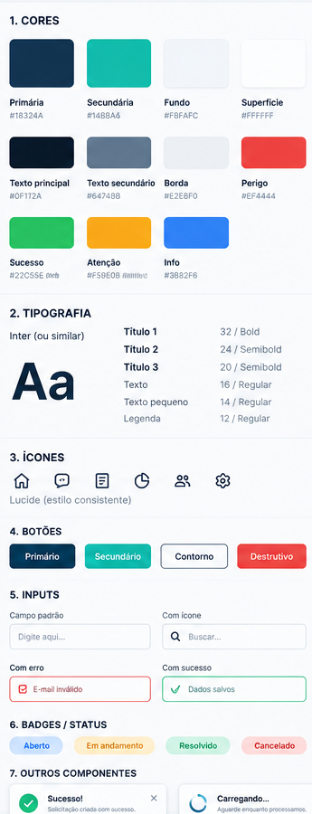
</p>

### 1. Paleta de Cores
| Nome do Token | Valor Hex | Finalidade / Aplicação |
| :--- | :--- | :--- |
| `--color-primary` | `#18324A` | Azul Profundo: cabeçalhos, sidebar, botões primários e identidade institucional. |
| `--color-secondary` | `#14B8A6` | Verde-água: destaques visuais, botões secundários, foco acessível e badges de sucesso. |
| `--color-bg` | `#F8FAFC` | Plano de fundo suave da aplicação para máximo conforto visual. |
| `--color-surface` | `#FFFFFF` | Superfície dos cards, tabelas, modais e formulários. |
| `--color-text-primary` | `#0F172A` | Títulos e texto de alta ênfase (contraste AA/AAA). |
| `--color-text-secondary` | `#64748B` | Textos de apoio, legendas e descrições auxiliares. |
| `--color-border` | `#E2E8F0` | Contornos discretos, divisores de tabela e inputs. |
| `--color-danger` | `#EF4444` | Alertas de erro, ações destrutivas e prioridade Alta. |
| `--color-warning` | `#F59E0B` | Status Em andamento e prioridade Média. |
| `--color-info` | `#3B82F6` | Status Aberto e informativos. |
| `--color-success` | `#22C55E` | Status Concluída / Resolvida e prioridade Baixa. |

### 2. Tipografia
- **Família:** `Inter`, com fallbacks do sistema `ui-sans-serif, system-ui, -apple-system`.
- **Título 1:** `32px` / Bold (700) / Line-height `1.25`
- **Título 2:** `24px` / Semibold (600) / Line-height `1.3`
- **Título 3:** `20px` / Semibold (600) / Line-height `1.35`
- **Corpo de Texto:** `16px` / Regular (400) / Line-height `1.5`
- **Texto Pequeno:** `14px` / Regular (400) / Line-height `1.45`
- **Legenda:** `12px` / Regular (400) / Line-height `1.4`

### 3. Escala de Espaçamento e Formas
- **Espaçamentos:** `4px`, `8px`, `12px`, `16px`, `24px` e `32px`.
- **Raios de Borda:** `8px` a `12px` para cartões e inputs; `9999px` (estilo *pill*) para badges de status.
- **Sombras:** Sombras sutis calculadas sobre azul profundo (`rgba(24, 50, 74, 0.04)` a `0.15`).

---

## 📱 Páginas e Fluxos Principais

O sistema mantém estritamente **3 páginas principais** carregadas sob demanda (*lazy-loading*), protegidas por guardas de rota (*navigation guards*):

### 1. Dashboard (`/`)

<p align="center">
  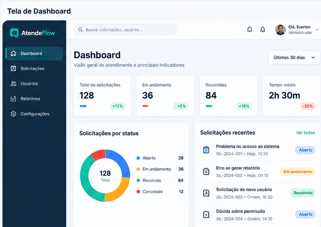
</p>

<p align="center">
  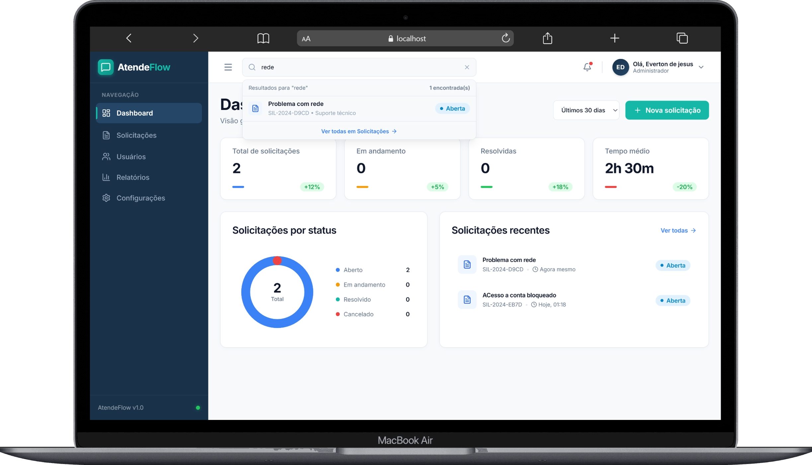
</p>

- **Indicadores Executivos (`StatCard`):**
  - **Total de solicitações:** contagem real com badge de evolução (`+12%`).
  - **Em andamento:** volume em tratamento com badge (`+5%`).
  - **Resolvidas:** total de demandas finalizadas (`+18%`).
  - **Tempo médio:** métrica de SLA de atendimento com indicador (`2h 30m`).
- **Gráfico Donut Vetorial SVG:**
  - Segmentos calculados dinamicamente para os status: Aberto (azul), Em andamento (âmbar), Resolvido (verde) e Cancelado (vermelho).
  - Centro do donut exibindo a contagem total consolidada.
  - Legenda interativa à direita com valores numéricos por categoria.
- **Solicitações Recentes:**
  - Lista com os últimos chamados registrados.
  - Identificação por protocolo (`SIL-2024-XXXX`), categoria e data relativa (*Hoje, 10:30* ou *Ontem, 14:10*).
  - Acesso direto com link *"Ver todas"* para a listagem completa.
- **Filtro de Período:** Dropdown para alternar entre 7, 15, 30 e 90 dias.

### 2. Solicitações (`/solicitacoes`)

<p align="center">
  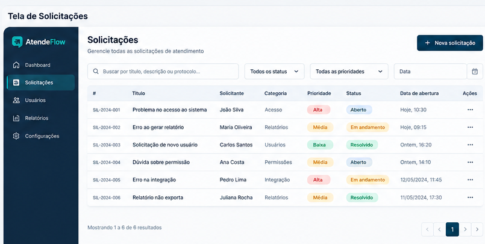
</p>

<p align="center">
  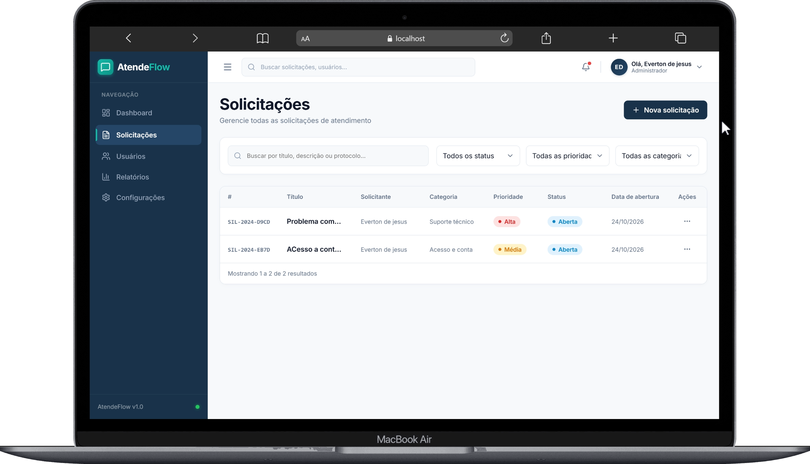
</p>

- **Busca e Filtros Cruzados:**
  - Campo de busca textual por título, descrição ou protocolo.
  - Filtro por Status (*Todas*, *Aberta*, *Em andamento*, *Concluída*).
  - Filtro por Prioridade (*Todas*, *Baixa*, *Média*, *Alta*).
  - Filtro por Categoria (*Suporte técnico*, *Acesso e conta*, *Cadastro*, *Relatórios*, *Financeiro*, *Outro*).
- **Tabela de Dados (`DataTable`):**
  - Colunas formatadas: `# Protocolo`, `Título`, `Solicitante`, `Categoria`, `Prioridade`, `Status`, `Data de Abertura` e `Ações`.
  - Hover suave nas linhas e container com rolagem horizontal automática em dispositivos móveis.
  - Paginação completa com botões de navegação anterior/próxima e contagem de registros (*Mostrando 1 a 6 de X resultados*).
- **Gestão de Solicitações:**
  - Botão **"+ Nova solicitação"** abrindo modal com validação inline.
  - Menu de ações com edição de dados, alteração rápida de status em um clique e exclusão com diálogo seguro.

<p align="center">
  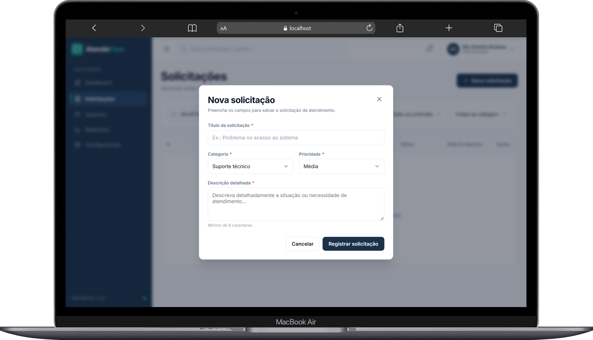
</p>

### 3. Acesso (`/login` e `/acesso`)

<p align="center">
  
</p>

- **Split-Card Institucional:**
  - **Lado Esquerdo (Azul Profundo #18324A):** Apresentação da marca, logotipo oficial e lista de benefícios com checkmarks circulares (*Atendimento mais organizado*, *Acompanhamento em tempo real*, *Equipe mais produtiva*, *Tudo em um só lugar*).
  - **Lado Direito (Superfície #FFFFFF):** Abas integradas **"Entrar"** e **"Cadastrar"** com indicador animado verde-água.
- **Formulário Seguro:**
  - Campo de e-mail com ícone `Mail`.
  - Campo de senha com ícone `Lock` e botão alternador de visibilidade (`Eye` / `EyeOff`).
  - Campo de nome completo no cadastro.
  - Checkbox *"Lembrar de mim"* e link *"Esqueceu a senha?"*.
  - Botão primário com spinner de carregamento e botão social *"Entrar com Google"*.

### 4. Layout Responsivo Multiplataforma

<p align="center">
  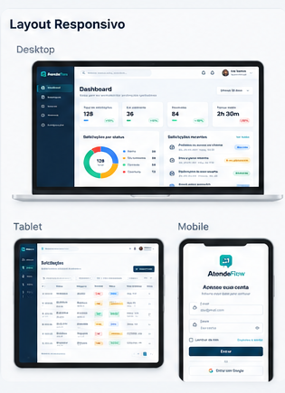
</p>

- **Desktop (Monitores & Notebooks):** Experiência com barra lateral fixa expansível, cabeçalho rico com busca global integrada, tabelas completas com ordenação e dashboard analítico.
- **Tablet (iPads & Tablets Android):** Menu retrátil inteligente acionado por hambúrguer, tabelas com scroll horizontal fluido e grids que se reorganizam automaticamente para 2 colunas.
- **Mobile (Smartphones iOS & Android):** Sidebar em gaveta *off-canvas* com backdrop suave, formulários adaptados em coluna única e toques com alvos mínimos acessíveis (44px+)..

---

## 🛠 Recursos do Sistema & Modais Auxiliares

Em vez de criar páginas desnecessárias, os recursos complementares foram arquitetados como **componentes reativos globais** orquestrados pela store Pinia `useUiStore`:

| Recurso | Componente | Descrição e Funcionalidades |
| :--- | :--- | :--- |
| **Busca Global Instantânea** | [AppHeader.vue](file:///f:/PROJETOS-2026/AtendeFlow/client/src/components/AppHeader.vue) | Campo no cabeçalho com popover de autocomplete em tempo real. Exibe resultados correspondentes de solicitações e permite teclar `Enter` para filtrar diretamente a listagem. |
| **Meu Perfil** | [UserProfileModal.vue](file:///f:/PROJETOS-2026/AtendeFlow/client/src/components/UserProfileModal.vue) | Visualização de dados do usuário autenticado, crachá de função, edição de nome e atualização de senha (com confirmação da senha atual e nova senha de 8+ caracteres). |
| **Gestão de Usuários e Equipe** | [UsersManagementModal.vue](file:///f:/PROJETOS-2026/AtendeFlow/client/src/components/UsersManagementModal.vue) | Lista todos os membros cadastrados no SQLite, com filtro por nome/e-mail, formulário para convidar/adicionar novos membros (`POST /api/users`) e exclusão de contas com modal de confirmação. |
| **Relatórios e Indicadores** | [ReportsModal.vue](file:///f:/PROJETOS-2026/AtendeFlow/client/src/components/ReportsModal.vue) | Painel analítico com taxa de resolução percentual, SLA médio, barras de volume por categoria e medidores por prioridade. Inclui botões funcionais para **Exportar Planilha CSV** e **Exportar Backup JSON**. |
| **Configurações do Sistema** | [SettingsModal.vue](file:///f:/PROJETOS-2026/AtendeFlow/client/src/components/SettingsModal.vue) | Configuração de categoria e prioridade padrão para novas demandas, toggles de notificações e diagnóstico do banco de dados SQLite com opção de limpeza de cache local. |
| **Diálogo de Confirmação** | [ConfirmDialog.vue](file:///f:/PROJETOS-2026/AtendeFlow/client/src/components/ConfirmDialog.vue) | Modal com backdrop blur e captura de teclado (`Escape`) para proteger operações irreversíveis (como exclusão de solicitações e usuários). |
| **Sistema de Toasts** | [ToastNotification.vue](file:///f:/PROJETOS-2026/AtendeFlow/client/src/components/ToastNotification.vue) | Alertas flutuantes automáticos de sucesso, erro, atenção e informação disparados pelas stores. |

### Galeria dos Modais & Recursos em Execução

<table width="100%">
  <tr>
    <td width="50%" align="center">
      <strong>👥 Gestão de Usuários e Equipe</strong><br/>
      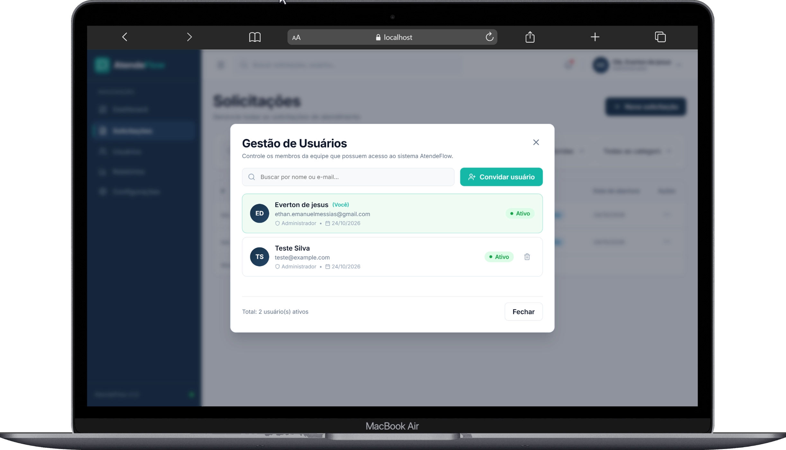
    </td>
    <td width="50%" align="center">
      <strong>📊 Relatórios, Métricas & Exportação CSV/JSON</strong><br/>
      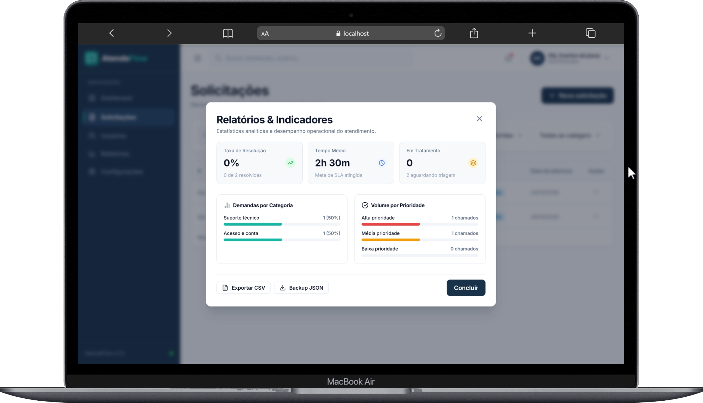
    </td>
  </tr>
  <tr>
    <td width="50%" align="center">
      <strong>⚙️ Configurações & Preferências do Sistema</strong><br/>
      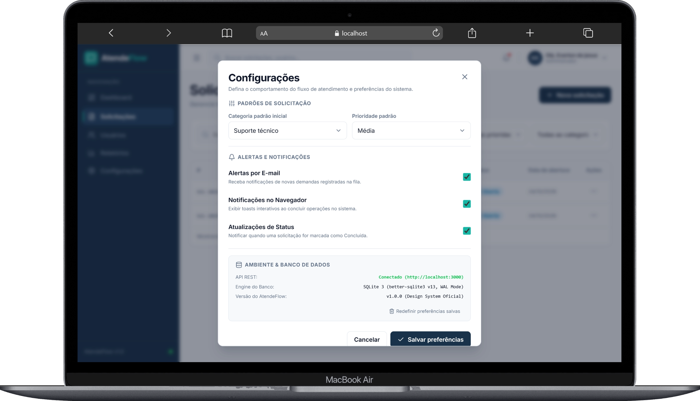
    </td>
    <td width="50%" align="center">
      <strong>👤 Perfil do Usuário & Alteração de Senha</strong><br/>
      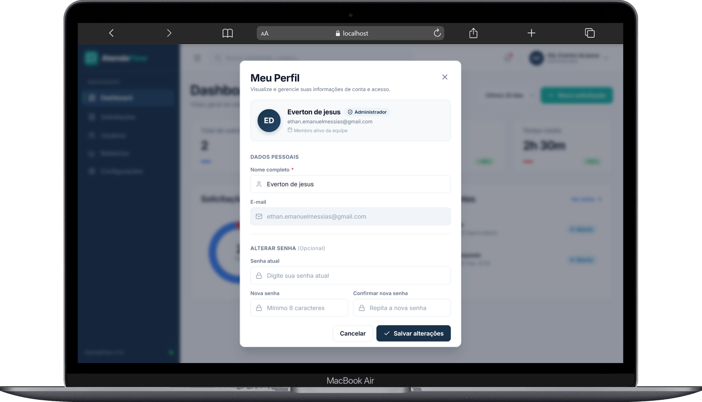
    </td>
  </tr>
</table>

---

## 🧩 Biblioteca de Componentes

Componentes reutilizáveis localizados em `client/src/components/`:

- `AppLayout.vue`: Shell da aplicação contendo Sidebar, Header, container responsivo e modais globais.
- `AppSidebar.vue`: Barra lateral com logotipo da marca, links ativos de rota e gatilhos para os modais de Usuários, Relatórios e Configurações.
- `AppHeader.vue`: Barra superior com busca global, sino de notificações com indicador, avatar com iniciais e menu do usuário.
- `BaseButton.vue`: Botão modular com suporte a variantes (`primary`, `secondary`, `outline`, `danger`, `ghost`), tamanhos (`sm`, `md`, `lg`) e estado de carregamento.
- `BaseInput.vue`: Input com label acessível, slots para ícones à esquerda/direita, feedback visual de erro/sucesso e suporte a WAI-ARIA.
- `BaseSelect.vue`: Select customizado com chevron estilizado e acessibilidade de foco.
- `StatusBadge.vue`: Tag em formato *pill* (`border-radius: 9999px`) com paleta cromática para Aberto, Em andamento, Resolvido, Cancelado e prioridades.
- `StatCard.vue`: Card de estatísticas com número em destaque, barra de indicador colorida e variação percentual.
- `DataTable.vue`: Tabela paginada com hover, cabeçalhos estilizados e slots customizados por coluna.
- `EmptyState.vue`: Ilustração amigável com ícone Lucide, título explicativo e botão de ação para estados vazios.
- `LoadingState.vue`: Spinner animado em verde-água (`#14B8A6`) e mensagem de processamento.
- `ConfirmDialog.vue`: Diálogo de confirmação para ações críticas.
- `ToastNotification.vue`: Container de toasts com transições animadas.
- `RequestCard.vue`: Card visual de solicitação mantido com 100% de compatibilidade para suítes de teste.

---

## 🏗 Arquitetura e Tecnologias

### Frontend (`@atendeflow/client`):
- **Framework:** Vue 3.5 (Composition API com `<script setup lang="ts">`).
- **Linguagem:** TypeScript 5.7 em modo estrito (`strict: true`).
- **Build Tool:** Vite 6.1 com suporte a Hot Module Replacement (HMR).
- **Gerenciamento de Estado:** Pinia 2.3 modular (`useAuthStore`, `useRequestsStore`, `useToastStore`, `useUiStore`).
- **Roteamento:** Vue Router 4.5 com rotas lazy-loaded e navegação autenticada.
- **Ícones:** Lucide Icons (`lucide-vue-next`).
- **Testes:** Vitest 3.2 com `@vue/test-utils` e ambiente `jsdom`.
- **Linting:** ESLint 9 (Flat Config com `typescript-eslint` e `eslint-plugin-vue`).

### Backend (`@atendeflow/server`):
- **Runtime:** Node.js (compatível com v18, v20, v22 e v24).
- **Framework Web:** Express 4.21.
- **Banco de Dados:** SQLite 3 via `better-sqlite3` v13 (compilado nativamente com suporte a WAL mode e foreign keys).
- **Segurança:** 
  - Hash de senhas com `bcryptjs` (salt 12).
  - Autenticação stateless via `jsonwebtoken` (JWT, expiração de 8h).
  - Headers HTTP seguros com `helmet`.
  - Proteção contra força bruta com `express-rate-limit`.
  - Controle de origem cruzada com `cors`.
- **Validação de Schemas:** `zod` com parsing tipado de requisições.

---

## 📡 Endpoints da API REST

A API responde no prefixo `/api`:

| Método | Rota | Autenticação | Descrição |
| :---: | :--- | :---: | :--- |
| `GET` | `/api/health` | Pública | Retorna o status de saúde da API (`status: ok`). |
| `POST` | `/api/auth/register` | Pública | Cria uma nova conta de usuário (`name`, `email`, `password`). |
| `POST` | `/api/auth/login` | Pública | Autentica um usuário e retorna o token JWT e dados do usuário. |
| `GET` | `/api/auth/me` | Bearer Token | Retorna os dados do usuário autenticado. |
| `PATCH` | `/api/auth/profile` | Bearer Token | Atualiza o nome ou altera a senha do usuário autenticado. |
| `GET` | `/api/requests` | Bearer Token | Lista solicitações do usuário com filtros opcionais (`q`, `status`, `priority`). |
| `POST` | `/api/requests` | Bearer Token | Cria uma nova solicitação (`title`, `description`, `category`, `priority`). |
| `PATCH` | `/api/requests/:id` | Bearer Token | Atualiza dados, status ou prioridade de uma solicitação existente. |
| `DELETE` | `/api/requests/:id` | Bearer Token | Exclui permanentemente uma solicitação. |
| `GET` | `/api/users` | Bearer Token | Lista os membros da equipe cadastrados no sistema. |
| `POST` | `/api/users` | Bearer Token | Cadastra/convida um novo membro da equipe. |
| `DELETE` | `/api/users/:id` | Bearer Token | Remove o acesso de um usuário (bloqueado para a própria conta). |

---

## 🗄 Modelo de Dados (SQLite)

O banco é criado automaticamente em `server/data/atendeflow.sqlite`:

```sql
-- Tabela de Usuários
CREATE TABLE IF NOT EXISTS users (
  id TEXT PRIMARY KEY,
  name TEXT NOT NULL,
  email TEXT NOT NULL UNIQUE,
  password_hash TEXT NOT NULL,
  created_at TEXT NOT NULL
);

-- Tabela de Solicitações
CREATE TABLE IF NOT EXISTS requests (
  id TEXT PRIMARY KEY,
  user_id TEXT NOT NULL REFERENCES users(id) ON DELETE CASCADE,
  title TEXT NOT NULL,
  description TEXT NOT NULL,
  category TEXT NOT NULL,
  status TEXT NOT NULL CHECK(status IN ('Aberta','Em andamento','Concluída')),
  priority TEXT NOT NULL CHECK(priority IN ('Baixa','Média','Alta')),
  created_at TEXT NOT NULL,
  updated_at TEXT NOT NULL
);

-- Índice para performance de listagem
CREATE INDEX IF NOT EXISTS idx_requests_user_created ON requests(user_id, created_at DESC);
```

---

## ⚡ Como Executar o Projeto

### Pré-requisitos
- **Node.js** >= 18 (validado no Node.js v24.20)
- **npm** >= 9

### 1. Clonar o Repositório
```bash
git clone https://github.com/evertonethan/AtendeFlow.git
cd AtendeFlow
```

### 2. Instalar Dependências
```bash
npm install
```

### 3. Configurar Variáveis de Ambiente
Crie ou verifique o arquivo `server/.env`:
```env
PORT=3000
JWT_SECRET=sua-chave-secreta-atendeflow-2026
CLIENT_ORIGIN=http://localhost:5173
DATABASE_PATH=./data/atendeflow.sqlite
```

### 4. Executar em Modo de Desenvolvimento
Inicie o backend e o frontend simultaneamente com um único comando:
```bash
npm run dev
```

- **Frontend (Interface Web):** [http://localhost:5173](http://localhost:5173)
- **Backend (API REST):** [http://localhost:3000](http://localhost:3000)

---

## 🧪 Testes e Qualidade de Código

### Executar a Suíte de Testes Unitários
```bash
npm test
```
*Executa os testes do servidor e do cliente via Vitest (13 testes aprovados cobrindo schemas Zod, botões, badges, inputs, paginação e modais de confirmação).*

### Executar a Análise de Linting (ESLint 9)
```bash
npm run lint
```
*Verifica regras de estilo e qualidade do TypeScript e componentes Vue sem nenhum erro ou aviso.*

### Compilar para Produção (Build)
```bash
npm run build
```
*Gera os binários TypeScript do servidor em `server/dist` e os bundles otimizados do cliente em `client/dist`.*

---

## 📄 Licença

Este projeto está sob a licença [MIT](./LICENSE) — sinta-se livre para utilizar, modificar e distribuir conforme necessário.

---

<p align="center">
  Desenvolvido com foco em excelência visual, performance e usabilidade • <strong>AtendeFlow 2026</strong>
</p>
